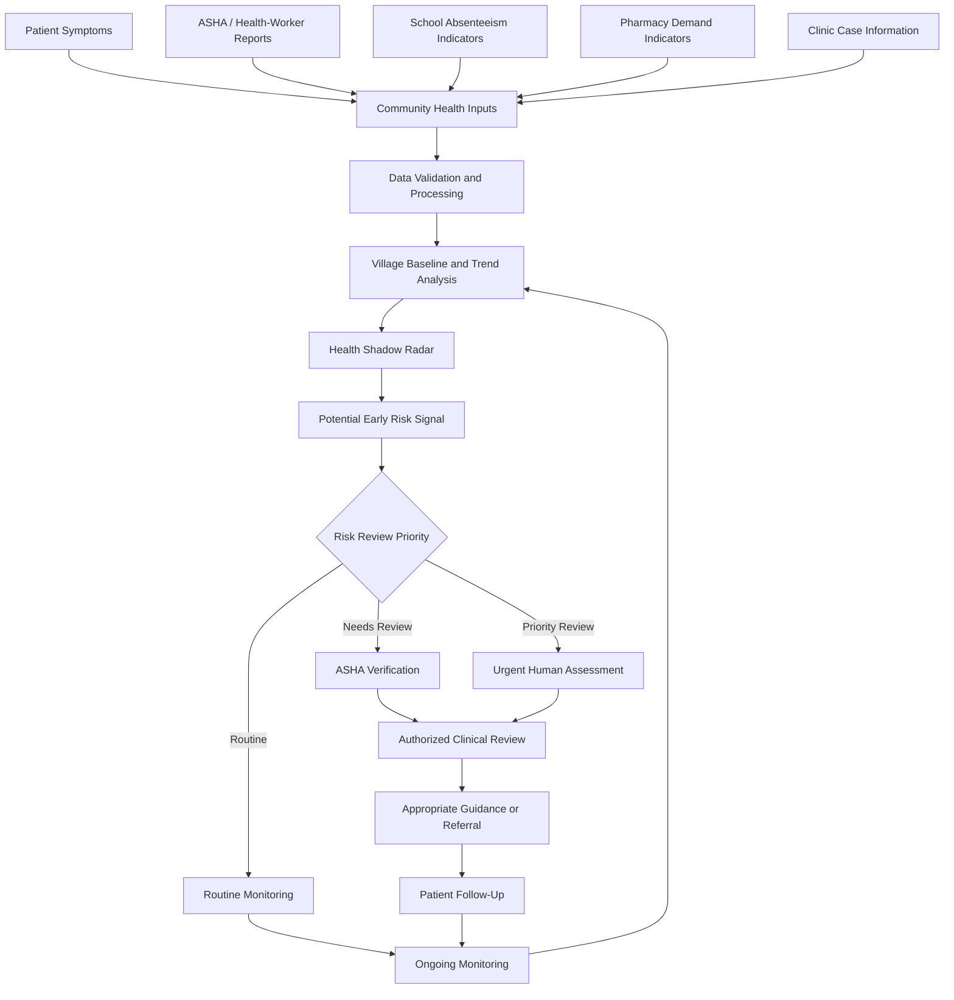

<div align="center">

# 🏥 MediMesh
### AI-Powered Rural Health Intelligence, Early Risk Detection & Continuous Care

**Detect Early. Verify. Act. Monitor. Improve.**

A community-centered healthcare prototype designed to support early health-risk awareness, coordinated rural care, and continuous patient follow-up.

[🚀 Live Demo](https://idyllic-fairy-dfc90a.netlify.app) · [📂 GitHub Repository](https://github.com/LOKESH-gits/MediMesh)

</div>

---

## 🌐 Live Application

**Explore MediMesh:** https://idyllic-fairy-dfc90a.netlify.app

MediMesh explores how digital tools can help connect community health signals, frontline healthcare workers, clinical review, and patient follow-up in underserved communities.

> **Prototype notice:** This project demonstrates a healthcare workflow. The availability and maturity of individual features depend on the current implementation. It is not a substitute for professional medical care or a validated disease-surveillance system.

---

## 📌 Table of Contents

- [Overview](#-overview)
- [Problem Statement](#-problem-statement)
- [Our Approach](#-our-approach)
- [Key Capabilities](#-key-capabilities)
- [System Architecture](#-system-architecture)
- [End-to-End Workflow](#-end-to-end-workflow)
- [Technology Stack](#-technology-stack)
- [Project Structure](#-project-structure)
- [Run Locally](#-run-locally)
- [Deployment](#-deployment)
- [Privacy and Safety](#-privacy-and-safety)
- [Future Enhancements](#-future-enhancements)
- [Author](#-author)

---

## 🎯 Overview

MediMesh is a rural healthcare intelligence and continuous-care prototype focused on improving visibility into community health needs.

The concept brings together community-reported symptoms, frontline health-worker observations, healthcare service information, risk review, and follow-up into a connected workflow.

Instead of treating every unusual pattern as a confirmed outbreak, MediMesh emphasizes **early risk signals followed by human verification and appropriate action**.

### Our Mission

Make community health information easier to understand, help coordinate healthcare responses, and support continuity of care in underserved communities.

---

## ⚠️ Problem Statement

Rural and underserved communities may face challenges such as:

- Delayed visibility into emerging community health concerns.
- Fragmented communication between patients and healthcare workers.
- Difficulties coordinating referrals and follow-up.
- Limited access to timely health information.
- Connectivity constraints in some communities.
- Difficulty identifying unusual patterns from scattered reports.

These challenges can make timely review and coordinated care more difficult.

## 💡 Our Approach

MediMesh proposes a connected digital workflow that can help organize health information, highlight potential changes in community trends, and route signals for human review.

The intended approach is to:

1. Collect relevant community health information.
2. Validate and organize available inputs.
3. Compare observed patterns against appropriate baselines.
4. Flag potential risks for review.
5. Support healthcare-worker verification.
6. Coordinate appropriate guidance and referrals.
7. Track follow-up and monitor changing conditions.

---

## ✨ Key Capabilities

The following are the project's intended capability areas. Actual implementation, integrations, and readiness should be confirmed against the current source code.

### 🛰️ 1. Health Shadow Radar

A concept for identifying unusual community health patterns from available indicators, with risk signals intended to support early review rather than declare an outbreak.

### 🧑‍⚕️ 2. ASHA and Healthcare-Worker Coordination

A workflow concept for helping frontline health workers review relevant reports, coordinate with authorized healthcare personnel, and support patient follow-up.

### 🩺 3. Patient Health and Follow-Up

A proposed connected-care workflow for organizing patient concerns, guidance, referral status, and follow-up information.

### 💊 4. Medicine and Healthcare Resource Awareness

A concept for improving visibility into medicine-related information and helping users locate appropriate healthcare resources. Medicine authenticity must not be claimed without a reliable verification source.

### 🌍 5. Community Health Intelligence

A framework for bringing together relevant community indicators, reviewing trends, and presenting information that may support healthcare planning.

### 📱 6. Responsive Web Experience

The project includes a web interface, styling, JavaScript modules, application assets, and progressive-web-app-related files.

### 🔐 7. Role-Aware Healthcare Workflows

The application can be extended to separate access and workflows for different healthcare participants. Production use requires verified authentication, authorization, and server-side access enforcement.

---

## 🏗️ System Architecture

The following diagram illustrates the **intended logical workflow** for MediMesh. It does not imply that every integration or analytical component is currently implemented.



### Architecture Layers

| Layer | Responsibility |
|---|---|
| Input | Organize relevant patient and community health information. |
| Processing | Validate inputs and prepare information for analysis. |
| Intelligence | Review available trends and flag potential anomalies. |
| Verification | Route risk signals for authorized human assessment. |
| Action | Support appropriate guidance, escalation, and referral. |
| Follow-up | Record follow-up outcomes and continue monitoring. |

**Important:** Any real-world implementation needs validated data sources, documented analytical methods, clinical oversight, and suitable security controls.

---

## 🔄 End-to-End Workflow

### Step 1 — Collect

Relevant patient and community health information is entered or supplied through supported interfaces.

### Step 2 — Validate

Available information is checked and organized before it is used in a workflow.

### Step 3 — Analyze

The intended analytical layer compares observations with appropriate historical or community baselines where reliable data is available.

### Step 4 — Generate a Risk Signal

Potentially unusual patterns can be flagged for further review. A signal is not proof of an outbreak or diagnosis.

### Step 5 — Verify

An authorized healthcare worker reviews the available evidence and determines the appropriate next step.

### Step 6 — Respond

Where appropriate, the workflow supports guidance, clinical assessment, escalation, or referral.

### Step 7 — Follow Up

Follow-up information can help authorized personnel review outcomes and monitor changing community needs.

---

## 🧰 Technology Stack

The repository contains the following technologies and project assets:

- **HTML5** — web page structure.
- **CSS3** — interface styling.
- **JavaScript** — application behavior and modules.
- **Node.js** — server-side runtime for the included server script.
- **JSON** — project configuration and structured data.
- **Progressive Web App components** — web manifest and service-worker files.
- **Netlify configuration** — deployment configuration.
- **Vercel configuration** — alternative deployment configuration.
- **Git and GitHub** — source control and project hosting.
- **Mermaid** — architecture diagrams rendered by GitHub Markdown.

The presence of a configuration or source file does not by itself prove that a service, database, AI model, or external integration is fully operational.

---

## 📁 Project Structure

```text
MediMesh/
├── .github/
│   └── workflows/
├── css/
│   └── style.css
├── icons/
│   ├── icon-192.png
│   ├── icon-512.png
│   ├── icon-maskable-512.png
│   └── icon.svg
├── js/
│   ├── app.js
│   └── pwa.js
├── scripts/
│   └── build.js
├── single-file/
│   └── medimesh.html
├── src/
│   ├── js1_core.js
│   ├── js2_engine.js
│   ├── js3_ui.js
│   ├── js4_public.js
│   ├── js5_pages_a.js
│   └── js6_pages_b.js
├── index.html
├── manifest.webmanifest
├── netlify.toml
├── package.json
├── server.js
├── sw.js
├── vercel.json
└── README.md
```

---

## 🚀 Run Locally

### Prerequisites

Install a supported Node.js version if you intend to run the included server or build scripts.

### 1. Clone the repository

```bash
git clone https://github.com/LOKESH-gits/MediMesh.git
cd MediMesh
```

### 2. Inspect the available scripts

```bash
cat package.json
```

### 3. Install dependencies if required

If the project defines npm dependencies, install them with:

```bash
npm install
```

If the package has no dependencies, this step may not be necessary.

### 4. Start the application

Use the start command defined in `package.json`. If a start script is configured, it will commonly be:

```bash
npm start
```

Otherwise, inspect the package scripts and `server.js` to identify the correct command.

### 5. Open the application

Follow the local address printed by the server. For a static-only preview, a compatible local HTTP server can be used to serve `index.html`.

**Note:** The correct startup command and any environment variables depend on the actual project configuration.

---

## ☁️ Deployment

### Live Demo

https://idyllic-fairy-dfc90a.netlify.app

### Deployment Configuration

The repository includes `netlify.toml` and `vercel.json`. These files provide deployment configuration for their respective platforms.

When updating the application:

1. Commit and push the intended source changes.
2. Confirm the hosting provider points to the correct repository and branch.
3. Verify build and publish settings.
4. Review deployment logs for errors.
5. Test the live application after deployment.

A successful source-code push does not automatically guarantee a successful deployment.

---

## 🔒 Privacy and Safety

Healthcare software must be designed with particular care.

- A risk signal must not be presented as a confirmed outbreak.
- The prototype must not replace professional medical advice or emergency services.
- Do not commit passwords, API keys, private tokens, or real patient records.
- Production deployments require secure authentication and server-side authorization.
- Health data should be minimized, protected, and accessed only by authorized users.
- Analytical outputs must be validated before they are used for real healthcare decisions.
- Offline and synchronization features require testing for data integrity and privacy.
- Medicine verification claims require trusted data sources and an appropriate verification process.

---

## 🛣️ Future Enhancements

Potential future development areas include:

- Validated community health anomaly detection.
- Explainable risk indicators and transparent review history.
- Secure role-based access and audit logs.
- Multilingual and low-connectivity workflows.
- Reliable offline data synchronization.
- Healthcare referral and follow-up integrations.
- Privacy-preserving community-level analytics.
- Automated tests, accessibility improvements, and deployment monitoring.

These items are future development possibilities, not claims that they are already complete.

---

## 👨‍💻 Author

**LOKESH B**

Project: MediMesh — Rural Health Intelligence and Continuous Care

- GitHub: https://github.com/LOKESH-gits
- Live Demo: https://idyllic-fairy-dfc90a.netlify.app

---

<div align="center">

**Built with a vision for more connected, accessible, and proactive community healthcare.**

*Created by LOKESH B*

</div>
